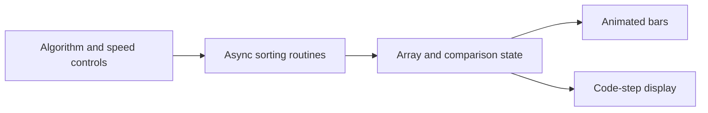

# Sorting Visualizer

**Connect sorting code to the array changes it produces.**

Next.js · TypeScript · React · Framer Motion · Tailwind CSS

## Purpose

Sorting algorithms are easier to understand when their comparisons and updates are visible. This application lets learners generate an array, choose an algorithm, and follow the animated execution alongside a code snippet.

## Features

- Bubble Sort, Quick Sort, and Merge Sort.
- Random array generation with adjustable size.
- Animation-speed controls.
- Comparison highlights and active code-line state.
- Start and stop controls for the current visualization.

## Preview


## Run locally

From the source directory, with Node.js/npm available:

```bash
npm install
npm run dev
```

Open [localhost:3000](http://localhost:3000). The project also defines `npm run build`, `npm start`, and `npm run lint`.

## Try a comparison

1. Generate a small array so each change is easy to follow.
2. Select Bubble Sort and lower the animation speed.
3. Start sorting and watch the highlighted bars and code.
4. Generate a new array and repeat with Quick Sort or Merge Sort.

## Architecture



The implementation lives primarily in [`app/page.tsx`](app/page.tsx). React state drives the bars and code highlights; refs retain the current array and cancellation flag during asynchronous work. Shared controls are in [`components/ui/`](components/ui/).

## Scope

This is a visual teaching application, not a sorting benchmark: intentional animation delays dominate elapsed time. Algorithm state is local to the browser session. The source currently generates random arrays; a custom-array input is not exposed by the page.
